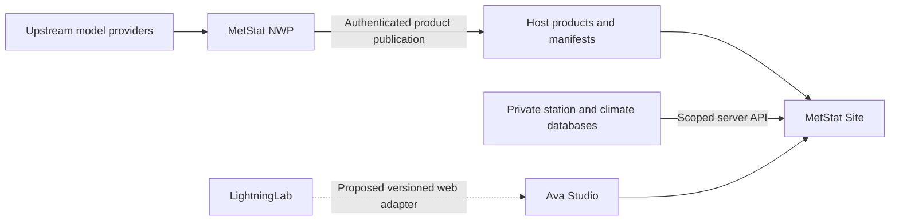

# MetStat architecture and release boundaries

One project, multiple independently versioned repositories. No history rewrite or repository merge is required.

- [metstat-site](https://github.com/monsoonrain83-hub/metstat-site): project entry point; web UI, climate tools, station/isohyet tools, server endpoints.
- [metstat-nwp](https://github.com/monsoonrain83-hub/metstat-nwp): scheduled numerical weather prediction processing and authenticated publishing of map/data products. Site consumes published products and manifests; the site is not the NWP processing runtime.
- [LightningLab](https://github.com/monsoonrain83-hub/LightningLab): Android lightning detection and atmospheric media editing/analysis. Ava Studio's web photo/video/lightning features are intended to reuse compatible functionality. The browser-compatible implementation, source version, licensing, parity tests and actual live wiring must be verified before claiming integration.

## Integration and operations

Keep deployment identities, release schedules, repository histories and runtime boundaries separate. For changes crossing repositories, document schema/contract version, compatible commits, reproducible test fixtures, rollback and artifact checksums. Do not require a production database or production access to build or test public code; provide lawful synthetic examples. A real browser and representative regression tests are necessary to validate the Ava Studio bridge; Android APK is not a web engine.

The site has existing historical source archives; a reproducible readable-source release is a future deliverable. The previously verified current R5 release must be the baseline, not an older zip. Legacy site deployment remains disabled until secure FTPS hostname validation and release safeguards are independently confirmed. Do not modify operational NWP schedules or upload endpoints in documentation changes.

## Data governance

Inventory data by source, license, path, Git history, public URL and production dependency. Private Atlas and rainfall station catalogs belong outside the web document root; retain tested encrypted backups and access-controlled keys. Expose minimal query/aggregate APIs; prevent unrestricted bulk downloads, enforce quotas and validate inputs. Public access to a map still exposes displayed values; rate limiting is not absolute prevention of extraction. Keep lawful demo data in the public repos. Separate provider data terms and attribution from source-code licensing. Do not move/delete live data until API equivalence and backup/rollback are verified. If private data was public, assess history, forks, caches and credential rotation; history rewriting is a separate high-risk operation.

## Security settings to verify

Protect main using required checks, review and no force push/deletion; restrict production environment secrets, use minimum workflow permissions and trusted branches, enable private vulnerability reporting, dependency alerts and secret scanning where available. This document specifies intended settings, not evidence they are enabled.
